# Facturo

<div align="center">


### Professional Invoice & Quotation Generator

**Create · Manage · Print**

A bilingual, privacy-focused invoicing application built with HTML5, CSS3, and Vanilla JavaScript.


<br />

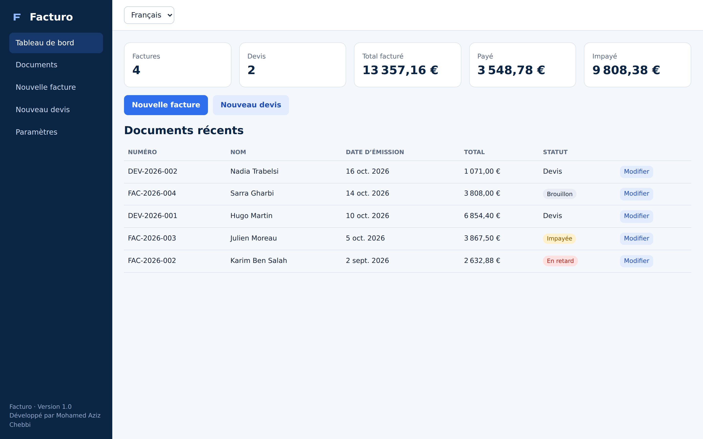

</div>

---

## Overview

**Facturo** is a lightweight web application for creating, managing, and printing professional invoices and quotations.

Built with pure HTML5, CSS3, and Vanilla JavaScript, it provides real-time financial calculations, document management, bilingual support, and print-ready A4 layouts — without frameworks or external dependencies.

## Features

- **Document Management** — Create, edit, duplicate, delete, search, filter, and sort invoices and quotations.
- **Financial Calculations** — Automatic subtotals, discounts, taxes, totals, payments, and outstanding balances.
- **Quotation Conversion** — Convert quotations into invoices while preserving document details.
- **Dashboard** — View document statistics, payment summaries, and recent activity.
- **Company Branding** — Configure company information, tax identification, payment details, and logos.
- **Internationalization** — Complete English and French interfaces and generated documents.
- **Multiple Currencies** — EUR, USD, GBP, TND, MAD, CAD, and CHF.
- **A4 Document Output** — Live previews and browser-native PDF printing.
- **Responsive Interface** — Desktop, tablet, and mobile layouts.
- **Local Persistence** — Store documents and settings using browser `localStorage`.

## Screenshots

### Document Management

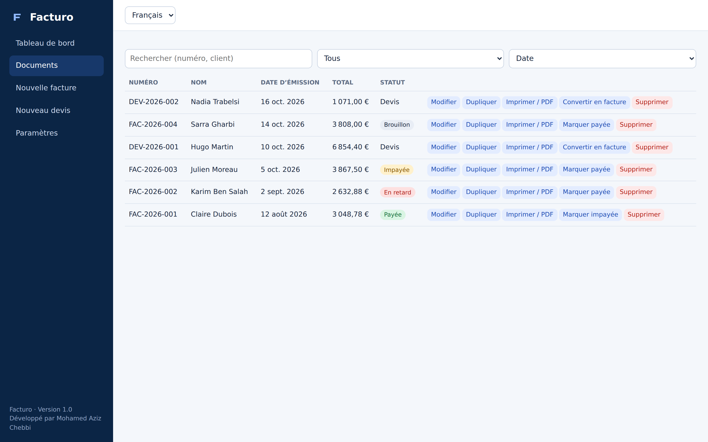

### Invoice Editor

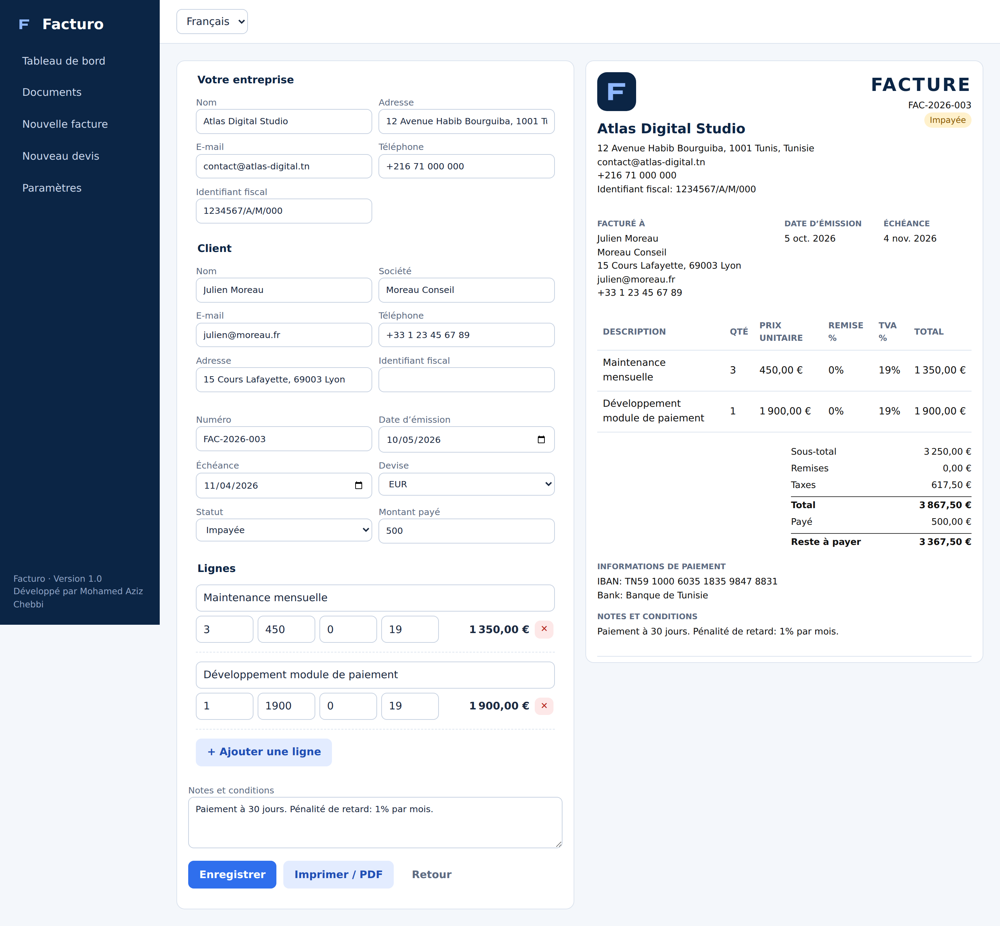

### Quotation Editor

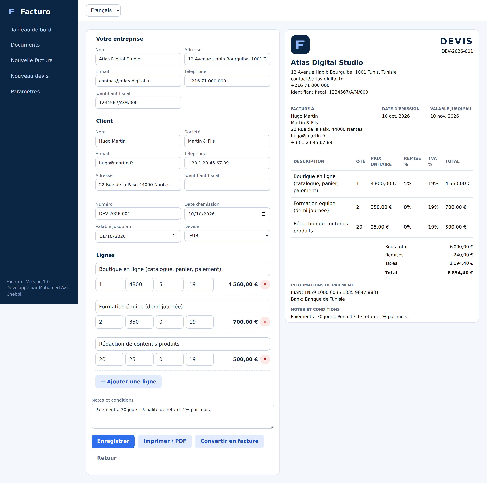

### Company Settings

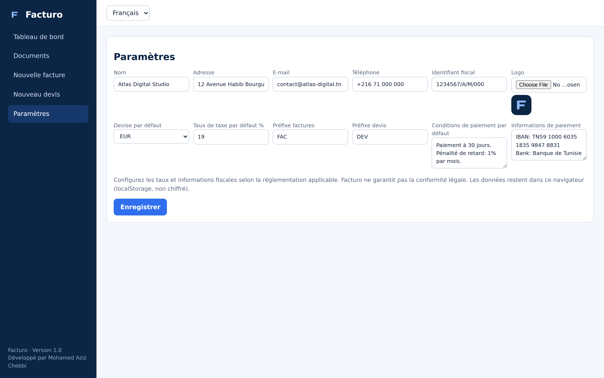

### English Interface

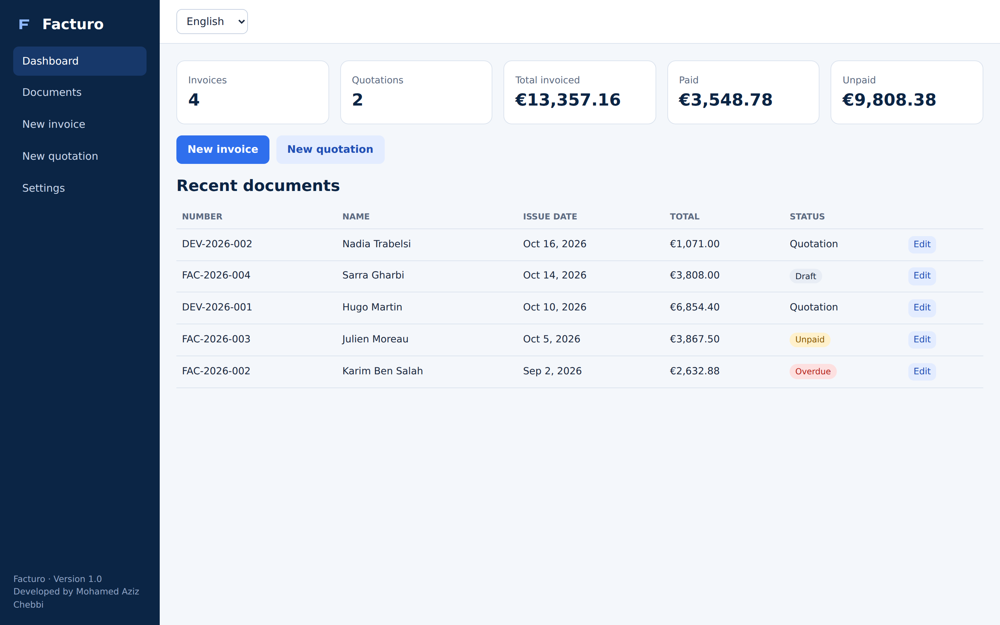

### A4 PDF Output

| Invoice | Quotation |
|:---:|:---:|
| 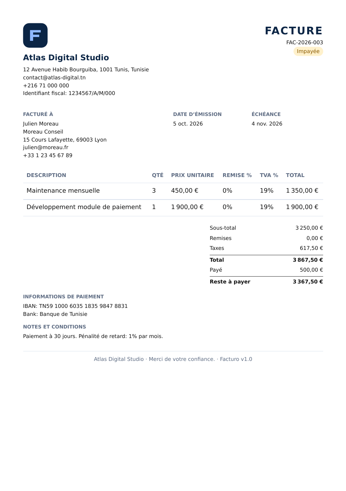 | 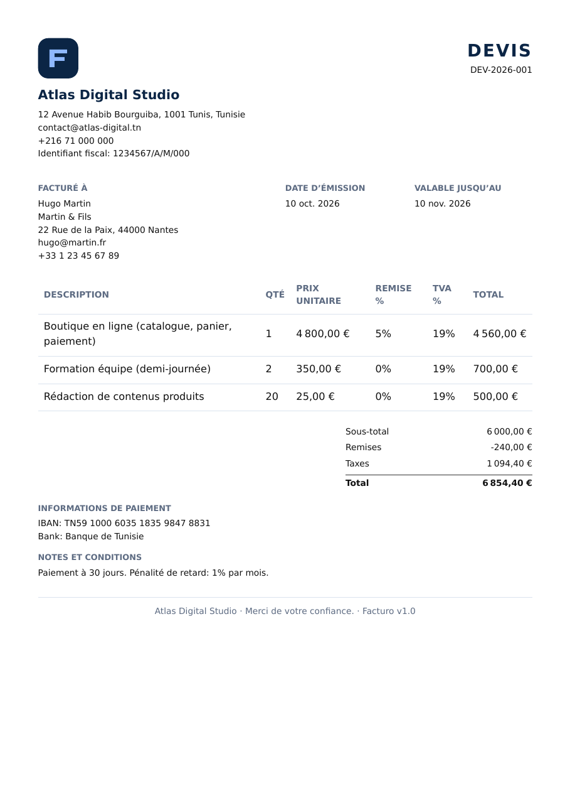 |

**Sample documents:** [Invoice PDF](assets/pdf-invoice.pdf) · [Quotation PDF](assets/pdf-quotation.pdf)

### Mobile Interface

| Dashboard | Navigation | Editor |
|:---:|:---:|:---:|
| 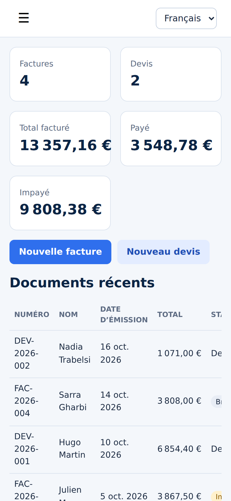 | 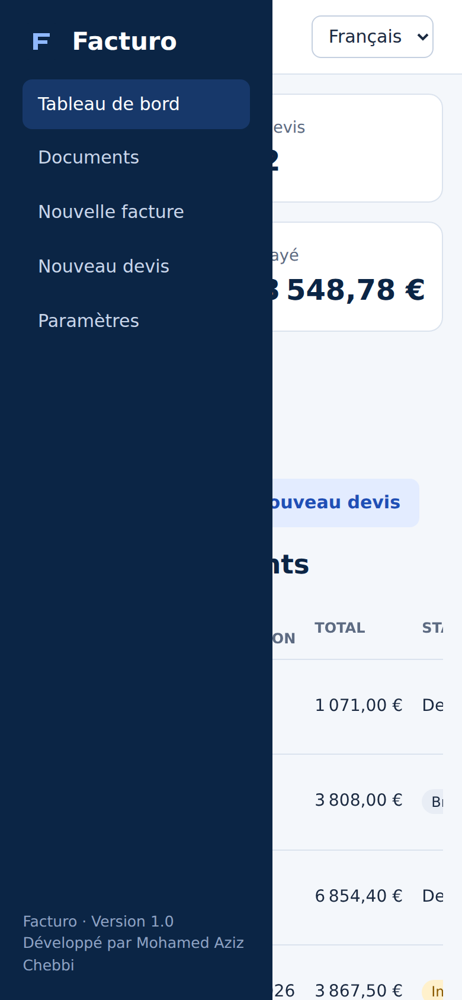 | 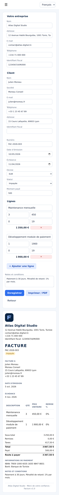 |

## Tech Stack

| Technology | Purpose |
|---|---|
| HTML5 | Semantic structure |
| CSS3 | Styling, Grid, Flexbox, responsive layouts, and print styles |
| Vanilla JavaScript | Application logic and financial calculations |
| LocalStorage | Client-side persistence |
| Intl API | Date and currency formatting |
| Browser Print | A4 documents and PDF output |

## Project Structure

```text
Facturo/
├── index.html
├── css/
│   ├── style.css
│   └── responsive.css
├── js/
│   ├── translations.js
│   ├── storage.js
│   ├── invoice.js
│   └── app.js
├── assets/
│   ├── logo.svg
│   ├── dashboard.png
│   ├── dashboard-en.png
│   ├── list.png
│   ├── editor-invoice.png
│   ├── editor-quotation.png
│   ├── settings.png
│   ├── pdf-invoice.png
│   ├── pdf-quotation.png
│   ├── mobile-dashboard.png
│   ├── mobile-menu.png
│   ├── mobile-editor.png
│   ├── pdf-invoice.pdf
│   └── pdf-quotation.pdf
├── README.md
└── LICENSE
```

## Getting Started

**1. Clone the repository**

```bash
git clone https://github.com/mohamedaziz-chebbi/Facturo.git
cd Facturo
```

**2. Launch the application**

Open `index.html` in your browser, or use the Live Server extension in Visual Studio Code.

No installation, build process, or package manager is required.

## Technical Highlights

- Modular JavaScript architecture with separated application logic, storage, calculations, and translations.
- Reusable document rendering for live previews and printed output.
- Centralized English and French translation dictionaries.
- Input validation and guarded local storage operations.
- Responsive layouts and print-specific CSS.
- No frameworks, external libraries, or CDN dependencies.

## Privacy & Limitations

- Application data is stored locally in the browser.
- Data is not encrypted by the application or synchronized across devices.
- Clearing browser site data may remove saved records.
- Mixed-currency totals are not automatically converted.
- Tax rates and fiscal information must be verified by the user.
- Facturo does not guarantee compliance with the invoicing regulations of any particular country.

## Roadmap

- [ ] JSON import and export
- [ ] CSV export and date-range filtering
- [ ] Client and product catalogs
- [ ] Partial payment tracking
- [ ] Automated tests
- [ ] Arabic language and RTL support
- [ ] Installable Progressive Web App (PWA)

## Developer

**Mohamed Aziz Chebbi**  
Computer Science Student

## License

Released under the [MIT License](LICENSE).

---

<div align="center">


**Facturo** · Version 1.0

Developed by **Mohamed Aziz Chebbi**

</div>